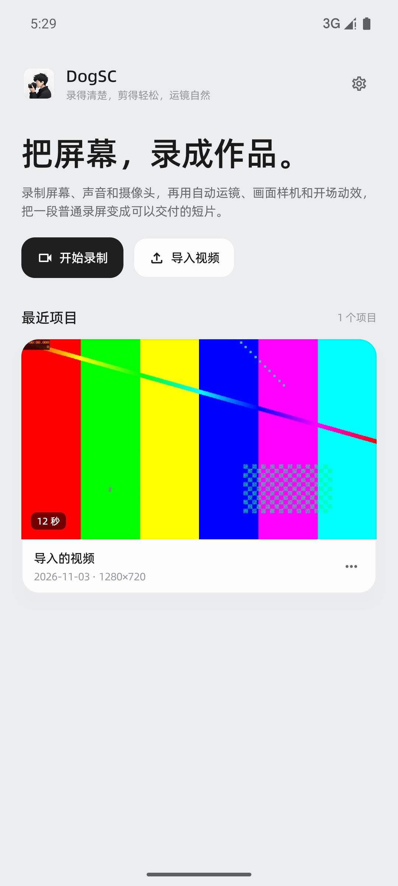
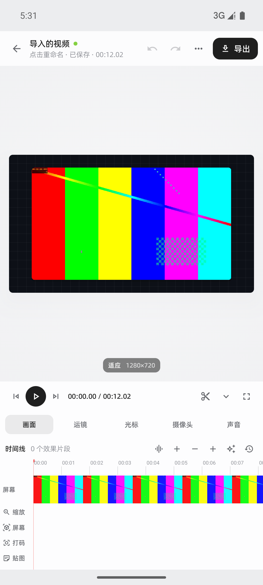
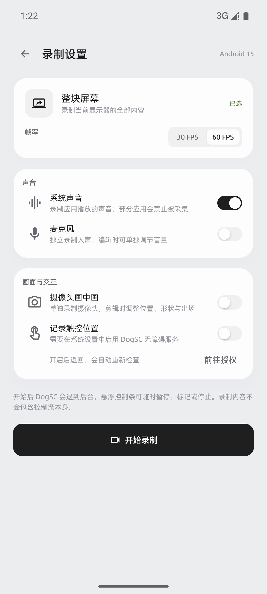
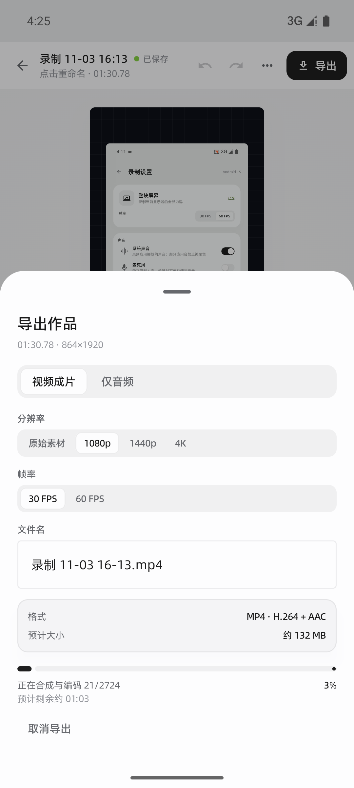
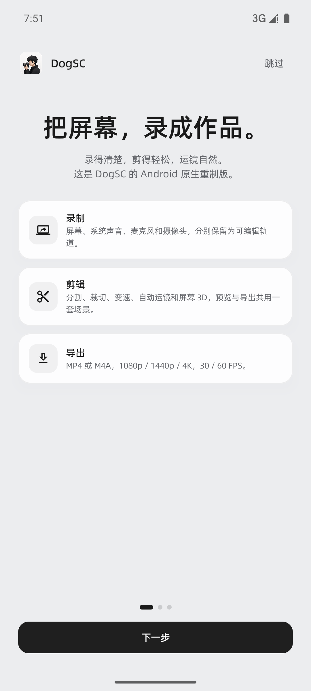
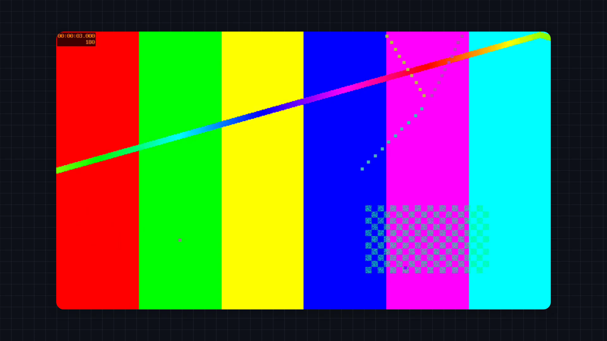

# DogSC Compose

<p align="center">
  
  &nbsp;&nbsp;
  
</p>

Unofficial Android port of [DogSC](https://github.com/laogou717/dogsc) (神烦老狗), rebuilt from scratch with Kotlin, Jetpack Compose and a shared product core.

DogSC Compose keeps the upstream product model — screen recording, system/microphone audio, camera picture-in-picture, primary-track editing, auto/manual zoom, screen 3D, opening sequences, canvas styling, mockups, stickers, mosaics/spotlight and MP4/M4A export — and adapts it to Android instead of stretching a macOS window onto a phone.

> DogSC is MIT-licensed. This repository preserves the upstream copyright, license and attribution notices. It is an independent port, not an official DogSC release.

## What is here

- **Project library** with thumbnails, duration, resolution, rename, duplicate and delete.
- **Screen recording** through `MediaProjection` (entire display), with an optional floating control bar that is excluded from the capture and a foreground-service notification.
- **System audio** through Android's `AudioPlaybackCapture` (apps may opt out) and **microphone** through `AudioRecord`, recorded as separate AAC tracks.
- **Camera picture-in-picture** recording through CameraX, independent from the screen track.
- **Touch/click capture** through an optional accessibility service; clicks and scroll positions become an editable cursor track.
- **Primary editing**: split, trim, ripple delete, restore cuts, undo/redo.
- **Timeline**: primary filmstrip, zoom, screen 3D, camera motion, mosaic and sticker tracks; playhead scrubbing, clip selection, edge trimming, snapping, markers, waveform and timeline zoom.
- **Scene model**: adaptive/fixed canvas ratios, source/1080p/1440p/4K, crop, padding, content position/scale, corner radius, border, shadow, background blur, five patterns, three dynamic flows, custom image/video backgrounds, window/browser/phone/tablet frames.
- **Motion**: auto zoom from touch clicks, manual zoom clips, focus effects, screen 3D, camera motion, opening sequences.
- **Cursor**: system arrow, pointing hand, crosshair, text cursor, open/closed hand, not-allowed, touch dot, hidden; click ripple/glow/pulse/burst; idle hiding; spring smoothing and tilt.
- **Stickers**: image import, layer order, width/rotation/opacity/corner/border/shadow, entrance/exit animation, hide screen/camera and backdrop blur.
- **Mosaics/spotlight**: timed soft-blur redaction or spotlight dimming with rounded regions.
- **Scene presets**: save/apply/delete appearance snapshots without touching media or timeline edits.
- **Export**: MP4 H.264 + AAC and M4A, 30/60 FPS, source/1080p/1440p/4K, with the same scene model used by the preview.

<p align="center">
  
  &nbsp;&nbsp;
  
  &nbsp;&nbsp;
  
</p>

## Architecture

```
core/        Pure Kotlin product core: project model, timeline math, zoom/motion,
             opening, stickers, pointer reconstruction, scene evaluation, editing,
             project codec and tests. No Android dependencies.
ui/          Compose Multiplatform product UI (commonMain) and the Android capture,
             media, renderer and export implementations (androidMain).
androidApp/  Android entry point, permissions, manifest and app shell.
```

The scene is evaluated once into an immutable `FrameScene`; the Compose preview and the export renderer consume that same contract. This is the boundary that lets Android and future Compose targets share the product instead of duplicating it.

## Build

Requirements: JDK 17+, Android SDK 36, NDK 27.2 (for the native YUV color conversion).

```bash
./gradlew :androidApp:assembleDebug
# or
./gradlew :androidApp:assembleRelease
```

The debug APK is at `androidApp/build/outputs/apk/debug/androidApp-debug.apk`.
Release uses the debug signing key in this repository so it can be installed for testing; replace it before distribution.

Install:

```bash
adb install -r androidApp/build/outputs/apk/release/androidApp-release.apk
adb shell am start -n dev.dogsc.app/.MainActivity
```

## Recording on Android

1. Grant screen recording when Android asks. On Android 14+ choose **Entire screen**.
2. Optionally grant the overlay permission for the floating control bar; without it, the foreground notification still provides pause/marker/stop.
3. System audio depends on the source app allowing playback capture; DogSC reports the capability but cannot override an app's opt-out.
4. Touch capture is optional and uses an accessibility service. It records click/scroll positions, not screen text or input content.
5. After stopping, DogSC returns to the editor with the recording already saved as a project.

## Verification

```bash
./gradlew :core:jvmTest
./gradlew :androidApp:assembleRelease
```

The core suite covers zoom hand-offs, auto-zoom grouping, scene geometry, crop/resolution rules, timeline split/delete/trim/restore, projection, sticker transitions and project round-trips.

A real exported frame from the Android pipeline:



## Known gaps

This is an honest status list, not a completion claim. See [PARITY.md](docs/PARITY.md) for the full map.

Resolved in the excellence pass (verified on the Android 15 emulator):

- **Direct canvas manipulation**: tap to select, drag to move, corner-handle resize, sticker rotation handle (±90° snap), snap reference lines + numeric capsule, haptics. Drags settle as one undo entry through a transient gesture channel. Covered by an injected-gesture instrumentation test.
- **Preview/export parity**: mosaic/focus coordinates unified to the screen-content rect; focus blur/softness and sticker backdrop (hide-screen / backdrop-blur) are now rendered in both backends (previously dead parameters); shadows use real low-res blur in preview; dynamic backgrounds share one pure geometry; layer order matches `scene.layerOrder`.
- **Motion & feel**: unified spring/tween motion tokens with reduced-motion support; button press feedback; switch thumb animation; magnetic-snap pulse ring; timeline edge auto-scroll; inspector sliding tab capsule; bar sliders with embedded value + double-tap exact entry; page transitions.
- **Editing**: multi-select (long-press) + batch delete, clip copy/paste + attribute paste, Q/W ripple trim, Esc, full keyboard shortcut sheet.
- **Data safety**: rolling `previous/` manifest backups on every save.
- **Export**: a Surface-input H.264 encoder (GLES texture upload, hardware color conversion) is preferred with the CPU YUV path kept as a fallback; rotated-source scrubbing uses a frame-level LRU cache.

Still open / honest boundaries:

- **GPU rendering (6b)**: the export renderer is still CPU Canvas. The Surface-input encoder removes the YUV copy, but on the software-GL emulator it is not faster than the native CPU path at 720p — the bottleneck is Canvas rendering, not encoding. A GLES shader renderer (shadows/blur/3D homography on GPU) is the real path to ≥3× realtime and **requires physical-device hardware GL to validate**; it is not claimed done here.
- Camera recording (CameraX, single-lens fallback) is verified on the emulator's virtual lenses, not yet on physical sensors.
- Continuous pointer motion depends on what the accessibility service exposes (Android 14+ streams motion; older versions use click/scroll anchors).
- The PCM audio mixer is used when volume/mix settings cannot take the fast copy path; it is slower than the copy path.
- iOS/desktop/web targets remain outside this Android-first round.
- Test suite: 62 core JVM tests + 2 UI unit tests + 2 instrumentation tests (pinch + canvas manipulation), green. Physical-device camera/HEVC checks still pending.

## License

Source code is MIT-licensed; see [LICENSE](LICENSE) and [NOTICE](NOTICE). The bundled Alibaba PuHuiTi 3.0 fonts follow their own license in [docs/licenses](docs/licenses). Upstream DogSC is Copyright (c) 2026 神烦老狗.
